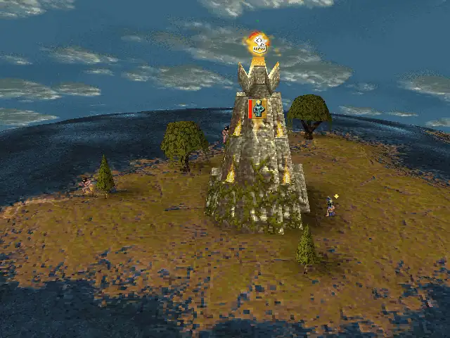
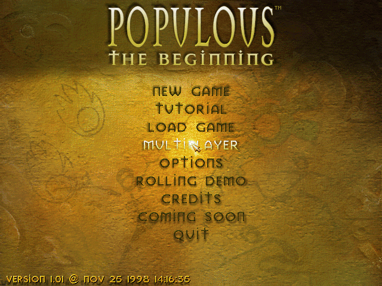
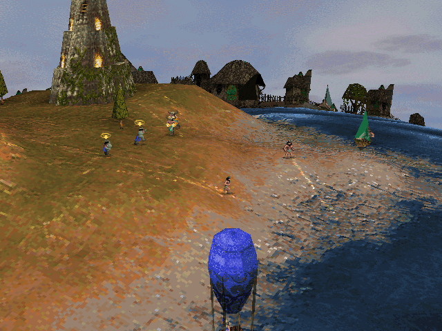
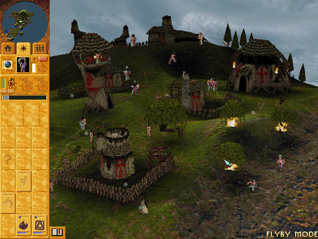

# OpenPopTB-MacOS

<p align="center">
  
</p>

<p align="center">
  
  
  
</p>
<p align="center"><sub>Captured from the native arm64 build (original 640x480 software renderer).</sub></p>

A native **Apple Silicon (arm64) macOS** port of **Populous: The Beginning** (1998) and its expansion
**Undiscovered Worlds**, built by **statically recompiling** the original Windows executables into C and
running them on a small reimplementation of the Win32/DirectX APIs on top of [SDL3](https://libsdl.org).

No emulator, no Wine, no virtual machine: the game's own x86 code is translated ahead of time and
compiled to a regular arm64 Mac app.

> **You must own the game.** This repository contains **no game code and no game data**. The build
> reads *your* copy of the game (the GOG release) and recompiles it locally on your Mac.
> See [Legal](#legal).

| | |
|---|---|
| Status | Single player fully playable (campaign, tutorial, Rolling Demo, Undiscovered Worlds) |
| Video | Original software renderer, 640x480 and 800x600 |
| Audio | Sound effects, music and FMV audio |
| Multiplayer | Not yet (work in progress, see [docs/MULTIPLAYER.md](docs/MULTIPLAYER.md)) |
| Platform | Apple Silicon; download needs macOS 14+, source build macOS 12+ |

## Quick start
### Download (no build needed)
1. Download `OpenPopTB-MacOS-x.y.z.zip` from the [releases page](https://github.com/iagodemacedo/OpenPopTB-MacOS/releases)
   and unzip it. It contains `Populous TB.app` and `Populous UW.app` (Undiscovered Worlds).
2. Open `Populous TB.app`. The apps are signed and notarized by Apple, so macOS opens them
   normally (it only asks once to confirm an app downloaded from the internet).
3. Choose your copy of the game: the GOG offline installer
   (`setup_populous_the_beginning_*.exe`, keep any `.bin` files next to it) or a folder that
   already contains `popTB.exe` (GOG Galaxy, CrossOver, Windows copy).
4. The first launch prepares the game: it recompiles *your* copy for your Mac, about one minute.
   This needs Apple's free Command Line Tools; if they are missing the app offers to install them
   (then open the app again). Later launches start in seconds.

The download contains no game code: it is the recompiler and the runtime, and the game code is
generated on your Mac from your files. The cache lives in
`~/Library/Application Support/OpenPopTB/cache/` (delete it to force a rebuild); a game unpacked
from the installer goes to `~/Library/Application Support/OpenPopTB/Game/`. The download needs
macOS 14 or later (building from source works on macOS 12+).

### Build from source
1. Get the game files from your GOG copy: the offline installer
   (`setup_populous_the_beginning_*.exe`) or a folder copied from a Windows, GOG Galaxy or CrossOver
   install. The folder must contain `popTB.exe`, `QMixer.dll`, `WEANETR.dll` and the `data/`,
   `levels/`, `sound/`, `fmv/` folders.
2. Install the build tools:
   ```sh
   xcode-select --install
   brew install cmake ninja sdl3 python innoextract
   ```
3. Build:
   ```sh
   git clone https://github.com/iagodemacedo/OpenPopTB-MacOS.git
   cd OpenPopTB-MacOS
   ./build.sh "/path/to/Populous The Beginning"
   # or straight from the installer (extracted into game/):
   ./build.sh --installer "/path/to/setup_populous_the_beginning_1.02_d3dfix_(76526).exe"
   ```
   This takes about a minute. It creates `dist/Populous TB.app` and, if `popTBUW.exe` is present,
   `dist/Populous UW.app`.
4. Run `open "dist/Populous TB.app"`. On first launch the app asks for the game folder and
   remembers it (`~/Library/Application Support/OpenPopTB/data_path.txt`).

To build the downloadable apps yourself: `tools/package_release.sh` (needs no game files).

### Hi-res (Direct3D) build
If the game folder contains `D3DPopTB.exe` / `D3DPopTBUW.exe` (the GOG release does), `build.sh` also makes
`dist/Populous TB D3D.app` and `dist/Populous UW D3D.app`: the same game, rendered on the GPU at your window's resolution with
antialiasing and filtered textures instead of the 640x480 software renderer. It is not part of the
prebuilt download yet.

### Graphics preset
The options screen's *Quick Defaults* preset starts at **High** (800x600, high landscape detail) in every build
on every launch, because the game itself forgets everything but the landscape detail. Set
`POPTB_PRESET=low|medium|off` to change that (`off` leaves the game's own state).

### Tested game version
The GOG release, version 1.01. `build.sh` and the app check these SHA-256 hashes and warn if yours differ
(other versions may work but are untested; the runtime has a few address-specific tweaks).

| File | SHA-256 |
|---|---|
| `popTB.exe` | `a46e7c6fa04e13f6cd5accebe32bb5f543f1cd0808bb96b0040f59763251109e` |
| `popTBUW.exe` | `d994142ce0ffb0e5a12ad432cd5def2020d3ca9fb6027a1469d9f7459071e760` |
| `QMixer.dll` | `460292fe61a75996e8035f8a65a765733738293d0d391336be292aa74c128698` |
| `WEANETR.dll` | `44f5ea804323b607c68739d90df3e9516390f4045c2779350372566c2a806418` |

## Playing
- **Cmd+Enter** toggles full screen, **Cmd+Q** quits.
- The mouse is captured while the window has focus (the game draws its own cursor, like the
  original fullscreen mode). Cmd+Tab releases it.
- Game options (resolution, landscape detail, sound) are in the game's own *Options* menu.
- Command-line flags: `--data <folder>` (game folder), `--installer <setup.exe>` (unpack the GOG
  installer and use it), `-v` / `-vv` (logging).
- Saves and settings are written by the game into the `save/` folder of your game directory,
  exactly like on Windows.

## How it works
```
popTB.exe, QMixer.dll, WEANETR.dll  (your copy)
        │  recomp/gen.py: capstone disassembly, recursive code discovery,
        │  x86 → C translation (one C function per x86 function)
        ▼
gen/*.c  (generated locally, never committed)
        │  + runtime/*.c: 4 GB guest address space, Win32 (kernel32, user32, ...),
        │    DirectDraw, DirectInput, DirectSound 3D, waveOut, Winsock, all on SDL3/POSIX
        ▼
Populous TB.app  (native arm64)
```
- The original `popTB.exe` and the `QMixer.dll` sound mixer are **both** recompiled; the game calls
  QMixer, QMixer calls our DirectSound, our DirectSound plays through SDL3.
- At run time the original PE files are loaded into a 4 GB guest address space so that all the
  game's data, tables and pointers stay at their original addresses.
- Correctness is checked with a **differential fuzzer** (every x86 instruction form used by the game
  is run in the [Unicorn](https://www.unicorn-engine.org/) emulator and in the generated C) and a
  **function-level replay** tool that compares whole functions instruction by instruction.

Details: [docs/ARCHITECTURE.md](docs/ARCHITECTURE.md). Everything we learned about the game
internals so far: [docs/FINDINGS.md](docs/FINDINGS.md).

## Repository layout
| Path | What |
|---|---|
| `build.sh` | One-shot build from your game folder or GOG installer |
| `recomp/` | The static recompiler (Python): `image.py` code discovery, `gen.py` x86→C, `fuzz.py` differential fuzzer |
| `runtime/` | The C runtime: CPU helpers, memory, threads, Win32/DirectX reimplementation on SDL3; `prepare.c` is the prebuilt app's first-launch recompilation |
| `tools/` | Debugging tools: run with scripted input and screenshots, crash symbolication, replay, disassembly |
| `re/` | Reverse-engineering inputs: function list exported from Ghidra (addresses only), export script |
| `src/` | An earlier hand-written terrain viewer (reference only, not used by the port) |
| `docs/` | Architecture, findings, file formats, debugging guide, roadmap |

## Contributing
Help is very welcome: rendering improvements, multiplayer, testing on more levels, docs.
Start with [CONTRIBUTING.md](CONTRIBUTING.md) and [docs/ROADMAP.md](docs/ROADMAP.md).

## Legal
- *Populous: The Beginning* is © 1998 Electronic Arts / Bullfrog Productions. This project is not
  affiliated with or endorsed by Electronic Arts, Bullfrog or GOG.
- This repository contains only original code (the recompiler, the runtime and tools) under the
  MIT license, plus a list of function addresses used to seed code discovery. It contains **no**
  game code, game data or assets.
- The build output (`gen/`, `build*/`, `dist/`) is derived from your copy of the game. **Do not
  redistribute it.** For the same reason, official releases never contain game-derived code: the
  prebuilt apps recompile the player's own copy on first launch (`tools/package_release.sh` refuses
  to package if it finds game-derived files).

## License
[MIT](LICENSE) for the contents of this repository. The license does not cover Populous: The Beginning,
its executables, libraries or data files, nor any code generated from them by this software.
